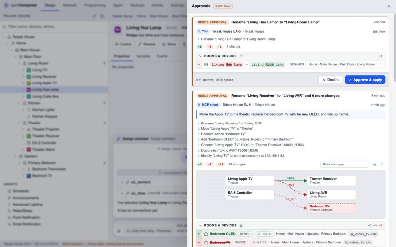
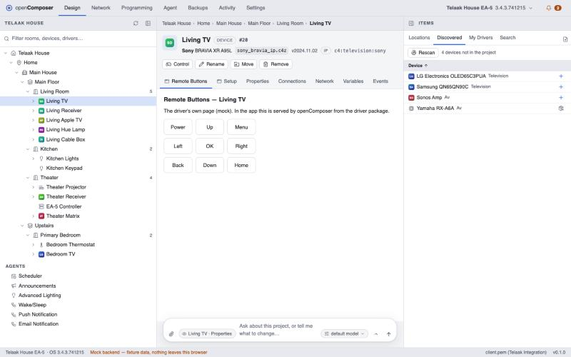
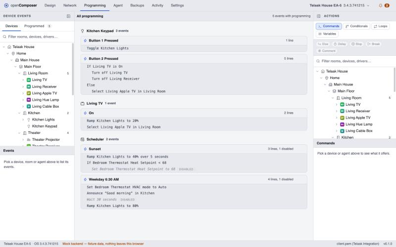
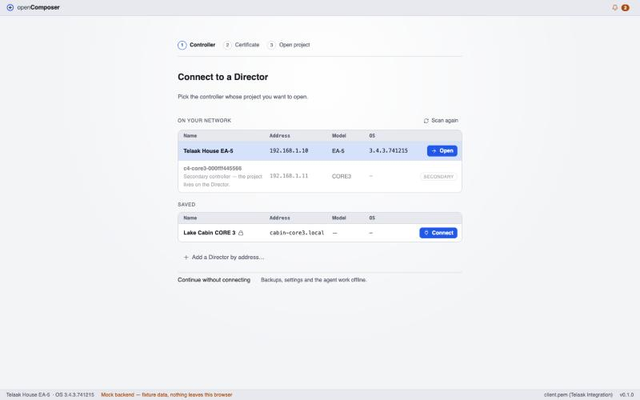

# openComposer

An independent desktop app for Control4 systems. Browse the project, drivers, connections,
network, Zigbee and programming; back up and load projects; and use it from AI assistants
over MCP, with an in-app agent chat.

Nothing changes on a controller until a person approves the change on a diff.

> **Not affiliated with or endorsed by Control4 or Snap One.** "Control4" and "Composer" are
> their trademarks, used here only to describe what this software works with. openComposer
> ships no Control4 software, certificates, keys or drivers — you supply your own, for
> controllers you own or are authorised to manage.

## Screenshots

Every write is shown as a plain-language diff and applied only after you approve it —
whether the change comes from you, an MCP client or the agent:



| Browse the project | Programming |
|---|---|
|  |  |

Connecting is a short wizard; it uses a client certificate your controller trusts, which
you provide.



> Screenshots use built-in fixture data, not a real system.

## Platforms

macOS, Windows and Linux. Builds of the latest `main` (macOS `.dmg`, Windows installer,
Linux `.deb` / `.rpm` / `.AppImage`) are on the [dev release](https://github.com/The1TrueJoe/openComposer/releases/tag/dev).

On Linux the certificate's key is kept in the desktop's Secret Service keyring (GNOME Keyring
or KWallet), so one has to be running and unlocked.

## Building

Needs Rust (stable) and Node 22. On Linux, also the WebKitGTK development packages; on
Debian/Ubuntu:

```bash
sudo apt install libwebkit2gtk-4.1-dev libgtk-3-dev libayatana-appindicator3-dev librsvg2-dev libssl-dev
```

Windows 10/11 needs the MSVC build tools (Visual Studio "Desktop development with C++") and
the WebView2 runtime, which current Windows already has.

```bash
npm ci --prefix ui
npx @tauri-apps/cli@2.12.3 dev --config app/tauri.conf.json
```

## License

openComposer is free for homeowners. Use it on your own system, change it, and share it with other DIYers.

It's meant to help homeowners look after their own systems. I want it to stay that way, not become something a big company builds a business on.

Because it's licensed under the [PolyForm Noncommercial License 1.0.0](LICENSE), commercial use needs my permission. That's mostly there for the edge cases: I don't want a large dealer or company turning it into a paid product or service without asking.

**Small dealers and independent integrators:** you're welcome to use it. Just email me at [joseph@telaak.dev](mailto:joseph@telaak.dev) and tell me a little about what you do. The answer will almost certainly be yes, free of charge. I'd just like to know who's using it.

**Larger dealers and companies:** please get in touch before using it commercially.

Contributions are accepted under the same license, and contributors agree that I may also offer them under a commercial license. These terms cover every version of openComposer back to the first commit.

Copyright © 2024–2026 Joseph Telaak.
