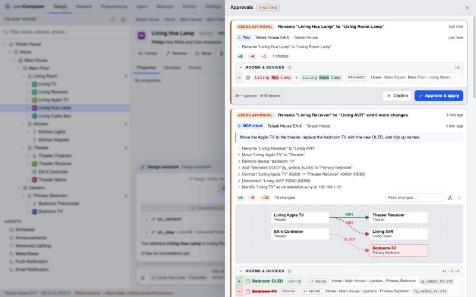
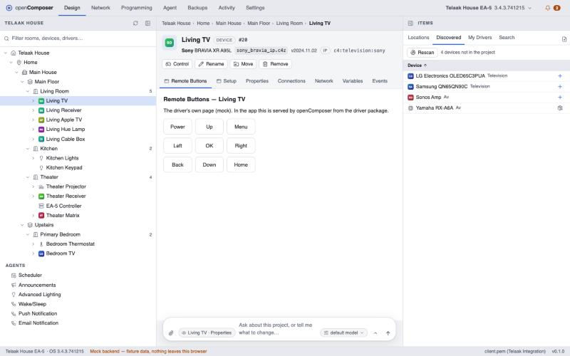
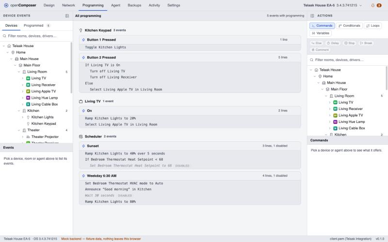
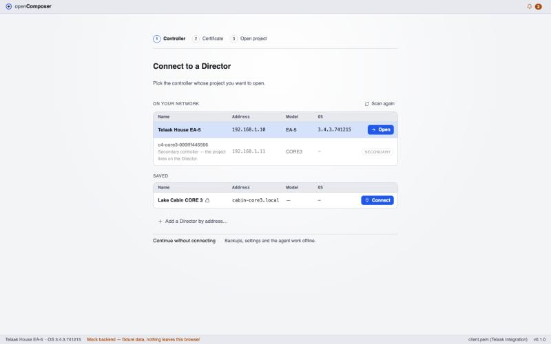

# openComposer

An independent desktop app for Control4 systems. Browse the project, drivers, connections,
network, Zigbee and programming; back up and load projects; and use it from AI assistants
over MCP, with an in-app agent chat.

Nothing changes on a controller until a person approves the change on a diff.

> **Not affiliated with or endorsed by Control4 or Snap One.** "Control4" and "Composer" are
> their trademarks, used here only to describe what this software works with. openComposer
> ships no Control4 software, certificates, keys or drivers — you supply your own, for
> controllers you own or are authorised to manage.

## Screenshots

Every write is shown as a plain-language diff and applied only after you approve it —
whether the change comes from you, an MCP client or the agent:



| Browse the project | Programming |
|---|---|
|  |  |

Connecting is a short wizard; it uses a client certificate your controller trusts, which
you provide.



> Screenshots use built-in fixture data, not a real system.

## Building

```bash
npm ci --prefix ui
npx @tauri-apps/cli@2.12.3 dev --config app/tauri.conf.json
```

## Layout

```
crates/c4   Director client: protocol, model, diff, ops, .c4p, SDDP, driver search
app         Tauri app: state, approvals, MCP server, stdio bridge, agent runner, commands
ui          React front end
poc         read-only Python probes
```
